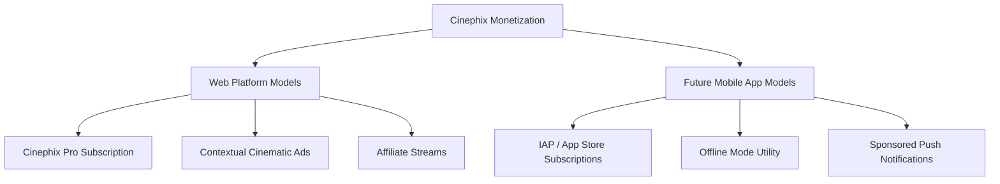

# Cinephix Revenue Model Strategy & Monetization Roadmap

Cinephix is a social cinema and community platform designed for movie enthusiasts. To ensure long-term sustainability, user trust, and a premium experience, this document outlines our comprehensive, multi-phased monetization strategy. 

Drawing inspiration from successful social utilities like Letterboxd, Serializd, and Goodreads, this roadmap balances user-centric value with realistic revenue engines across our current web application and our future mobile application.

---

## 1. Monetization Pillars & Revenue Streams



### Pillar A: Web Platform Revenue Models

#### 1. Freemium Subscription (`Cinephix Pro`)
A premium recurring subscription ($2.99/month or $19.99/year) designed for active film diarists, reviewers, and collectors.
*   **Ad-Free Browsing:** Full removal of native contextual ads, promotional cards, and affiliate banners.
*   **Custom Profile Styles & Themes:** Premium aesthetic upgrades, including:
    *   Custom profile header banners (supporting animated GIFs or movie backdrops).
    *   Sleek profile theme presets (e.g., *Classic Noir*, *Cyberpunk Neon*, *Technicolor*, *French New Wave*).
    *   Unique profile badges and avatar borders.
*   **Advanced Stats Filtering (CineGraph):** Enhancements to our core analytics tools, allowing users to filter their diaries and ratings by:
    *   Release decade, production country, or original language.
    *   Specific directors, actors, cinematographers, or production studios.
    *   Dynamic month-by-month and year-over-year diary activity comparison maps.
*   **Pinned Reviews & Lists:** Ability to pin up to 5 favorite movie lists or reviews to the top of the user’s public profile to highlight their best cinema writing.

#### 2. Non-Intrusive Contextual Ads
Ads on Cinephix must never feel generic or spammy. They should focus on content highly relevant to cinephiles: movie trailers, streaming premieres, local film festival tickets, and cinematic merchandise.
*   **Aesthetic Integration:** Ads will be contained inside clean DaisyUI/Tailwind layouts to preserve the platform's visual identity.
*   **DaisyUI Placeholder Boundary:** Using custom-styled DaisyUI cards with distinct border boundaries to match the website theme:
    ```html
    <!-- Example DaisyUI Contextual Ad Component -->
    <div class="card card-compact w-full bg-base-200 border border-base-300 shadow-sm transition-all hover:border-primary/40">
      <figure class="relative h-48 bg-neutral">
        
        <span class="absolute top-2 right-2 badge badge-neutral text-xs opacity-75">SPONSORED</span>
      </figure>
      <div class="card-body">
        <h2 class="card-title text-sm font-semibold text-primary">Now Streaming: The Neon Horizon</h2>
        <p class="text-xs text-base-content/70">Watch the award-winning sci-fi thriller exclusively on CineStream. Review & log it now!</p>
        <div class="card-actions justify-end mt-2">
          <a href="https://partner-link.com" target="_blank" rel="noopener noreferrer" class="btn btn-primary btn-xs btn-outline">Watch Trailer</a>
        </div>
      </div>
    </div>
    ```

#### 3. Affiliate Watch-Provider Integration
We will monetize outbound user traffic on movie detail pages by serving as a portal to digital marketplaces and streaming platforms.
*   **JustWatch/TMDB Integration:** Utilize APIs to fetch streaming/rental/purchase providers dynamically.
*   **"Where to Watch" Module:** A beautifully designed widget listing direct links to purchase or stream movies on platforms like Amazon Prime Video, Apple TV, Fandango, and Google Play.
*   **Affiliate Commission:** Integrate tracking IDs to earn a percentage of transaction values (e.g., 2%–7% on rentals or purchases) initiated through Cinephix.

---

### Pillar B: Future Mobile App Transition Strategy

As Cinephix expands to mobile platforms (iOS and Android), our monetization strategies will adapt to the mobile lifecycle and user behavior.

#### 1. In-App Purchases (IAP) & App Store Subscriptions
*   **Unified Account Billing:** Implement a cross-platform backend (via **RevenueCat**) to synchronize the user's `Cinephix Pro` status seamlessly across web profiles and mobile apps.
*   **One-Tap Upgrades:** Utilize Apple App Store In-App Purchases and Google Play Billing for low-friction subscription checkouts.
*   **Micro-transactions:** Introduce tipping/support models allowing users to tip their favorite film writers, with Cinephix retaining a small transaction commission (e.g., 10%).

#### 2. Offline Mode Access (Pro Exclusive)
Mobile usage demands reliability on the go (subways, planes, or theaters with poor reception). Offline capability is a powerful subscription driver:
*   **Offline Diary & Logging:** Write reviews, assign ratings, and record diary dates offline. The queue is synced automatically to the cloud once network connectivity is restored.
*   **Saved Watchlists:** Local database caching of user watchlists and essential movie metadata, ensuring the list is always accessible offline.

#### 3. Sponsored Push Notification Partnerships
Push notifications represent direct, high-attention channels. We will offer premium, highly targeted notifications from film studios and distributors:
*   **Curated Releases:** Notify opted-in community members when an indie film has opened in their area or when an anticipated trailer is released.
*   **Event Reminders:** Sponsored notifications for national film trivia nights, digital watchlist viewing parties, or global watch-alongs.
*   **Strict Quality Control:** Limit sponsored notifications to a maximum of 1 per week per user, keeping them highly relevant and fully dismissible.

---

## 2. Feature Comparison Matrix: Free vs. Pro

| Feature Category | Feature Detail | Free Tier | Cinephix Pro Tier |
| :--- | :--- | :---: | :---: |
| **Browsing** | Cinematic Platform Navigation |  (With Ads) |  (Ad-Free) |
| **Social** | Log, Rate, Review Movies |  |  |
| **Social** | Create & Share Movie Lists |  |  |
| **Customization** | Basic User Profile & Bio |  |  |
| **Customization** | Profile Banners & Animated Themes | ❌ |  |
| **Customization** | Pinned Reviews & Featured Lists | ❌ |  (Up to 5) |
| **Analytics** | Basic Stats (Yearly totals, average ratings) |  |  |
| **Analytics** | Advanced CineGraph Filtering (By Director, Country, etc.) | ❌ |  |
| **Mobile Integration** | Mobile App Access |  |  |
| **Utility** | Offline Syncing & Watchlist Caching | ❌ |  |
| **Support** | Priority Customer Support | ❌ |  |

---

## 3. Technical Implementation Plan

To keep overhead low and system architecture clean, we will implement monetization through modular integrations on top of our existing Vite/Node.js stack.

### Web Payments & Subscription Engine (Stripe)
```
[User Frontend (Vite)] ---> [Backend Server (Node.js/Express)] ---> [Stripe API]
          ^                                                            |
          |----------------- Webhook Notification <-------------------|
```
*   **Stripe Checkout:** Redirect users to Stripe-hosted checkout pages to handle secure subscriptions, card details, tax compliance, and recurring billing.
*   **Stripe Webhooks:** A secure Express route (`/api/v1/billing/webhook`) processes lifecycle updates (payment success, subscription renewal, cancellations) and modifies the database user flags (`isPro: true/false`).

### Affiliate Link Generation & Rendering
*   Use the **TMDB API** (or JustWatch API) to pull regional streaming and buy/rent availability on the movie detail page loading cycle.
*   Construct dynamic outbound affiliate links using standardized partner query parameters.
*   Implement client-side caching of watch providers (e.g., Redis on the backend or LocalStorage on the frontend) to minimize API cost and latency.

### Mobile Subscription Infrastructure (RevenueCat)
*   Integrate the `react-native-purchases` or `flutter_revenuecat` packages into the future mobile app codebase.
*   RevenueCat acts as the single source of truth, validating Apple App Store receipts and Google Play tokens and communicating subscription state directly to our Node.js database via secure server-to-server webhooks.

---

## 4. Short-Term & Long-Term Implementation Phases

```
┌─────────────────────────────────────────────────────────────┐
│ PHASE 1: WEB FOUNDATION (Months 1 - 4)                       │
├─────────────────────────────────────────────────────────────┤
│ ├─ Stripe Integration & Pro User database attributes        │
│ ├─ Premium Profile Banners & Pinned Reviews UI              │
│ ├─ CineGraph Advanced Filter Backend & Analytics dashboard  │
│ └─ TMDB / Affiliate Watch Provider integration             │
└─────────────────────────────────────────────────────────────┘
                              │
                              ▼
┌─────────────────────────────────────────────────────────────┐
│ PHASE 2: MOBILE & HYBRID EXPANSION (Months 5 - 12)          │
├─────────────────────────────────────────────────────────────┤
│ ├─ Mobile App build (React Native/Expo or Flutter)          │
│ ├─ RevenueCat integration for Unified Billing Sync         │
│ ├─ Local SQLite databases & Offline Sync worker             │
│ └─ Sponsored Push Notifications & Ad-Partner dashboard      │
└─────────────────────────────────────────────────────────────┘
```

### Phase 1: Web Foundation (Months 1–4)
*   **M1–M2: Subscriptions & Pro Perks**
    *   Integrate Stripe Checkout and update database schemas (`isPro`, `proTheme`, `pinnedReviews`).
    *   Implement user configuration screens for profile customizations (banners, themes).
    *   Build frontend logic to suppress ads and enable review pinning.
*   **M3–M4: Advanced Analytics & Affiliates**
    *   Develop API endpoints to run aggregated statistics queries (CineGraph stats by director, actor, country).
    *   Integrate TMDB/JustWatch streaming affiliate links onto the movie detail pages.
    *   Release the Pro Tier waitlist and launch early adopter discounts.

### Phase 2: Mobile Hybrid Transition (Months 5–12)
*   **M5–M8: Mobile Shell & RevenueCat**
    *   Develop the mobile application shell using React Native/Expo or Flutter.
    *   Incorporate the RevenueCat SDK, linking web subscriptions to mobile device IDs.
    *   Optimize the frontend layouts for responsive viewport transition.
*   **M9–M12: Offline Mode & Sponsored Notifications**
    *   Create an offline sync worker using SQLite/WatermelonDB to store watchlists and cache offline diary entries.
    *   Setup Expo Push Notifications or Firebase Cloud Messaging (FCM).
    *   Launch studio outreach for curated film sponsorship campaigns.
